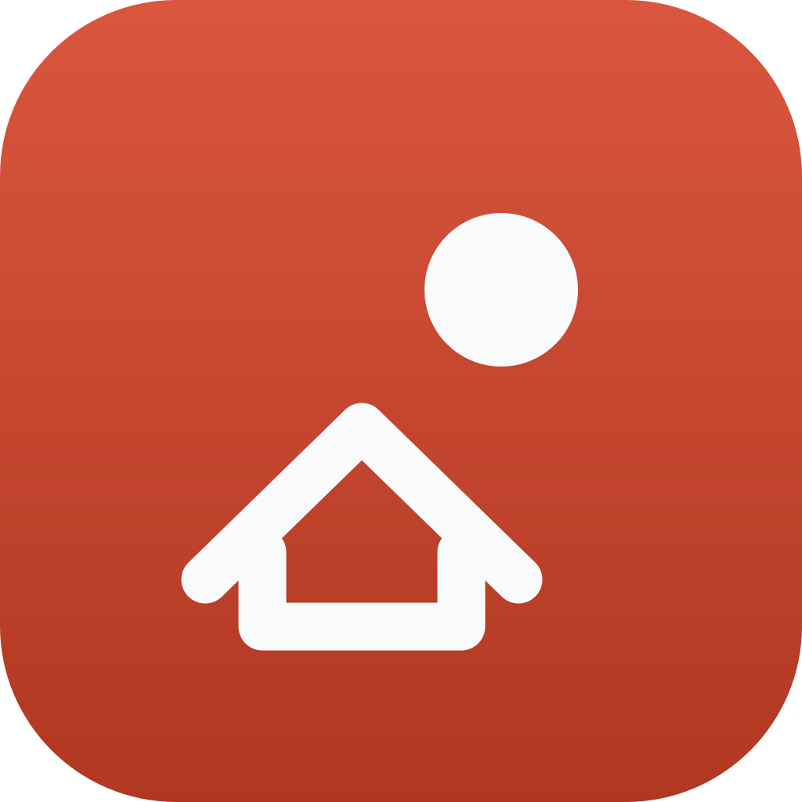
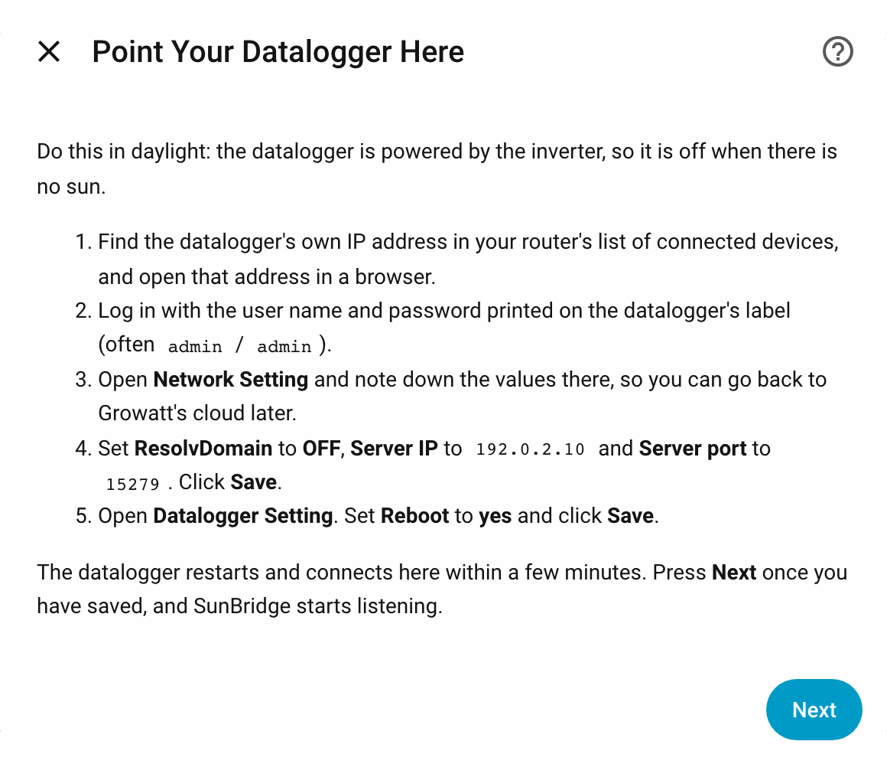
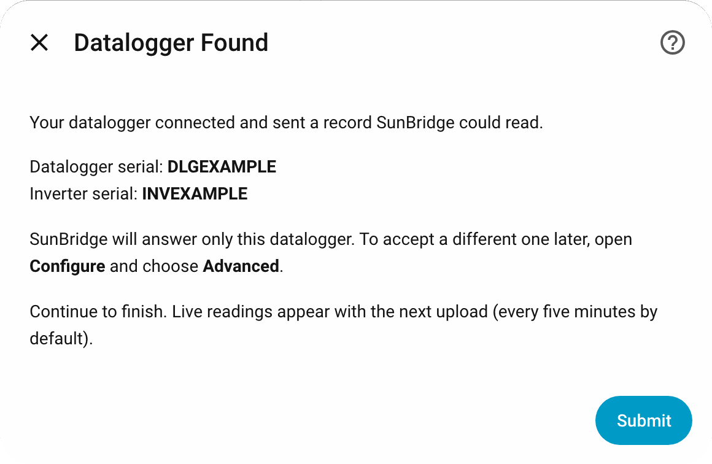
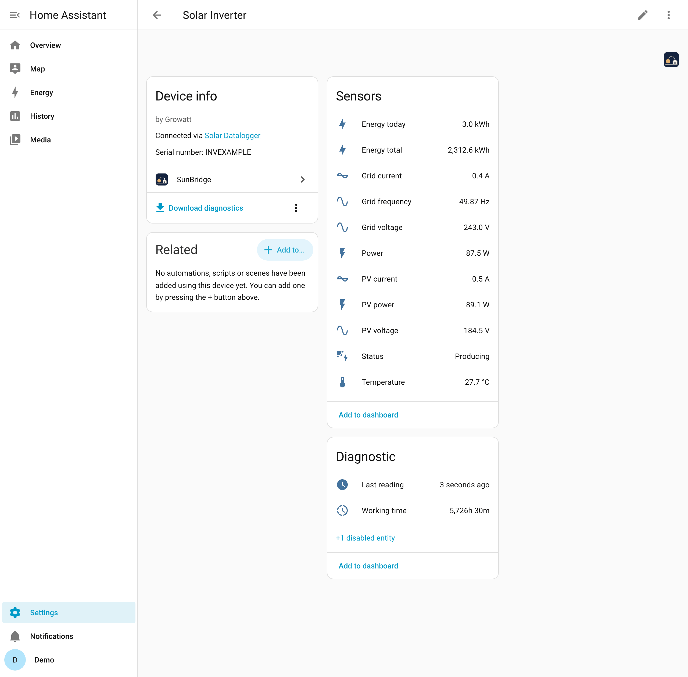
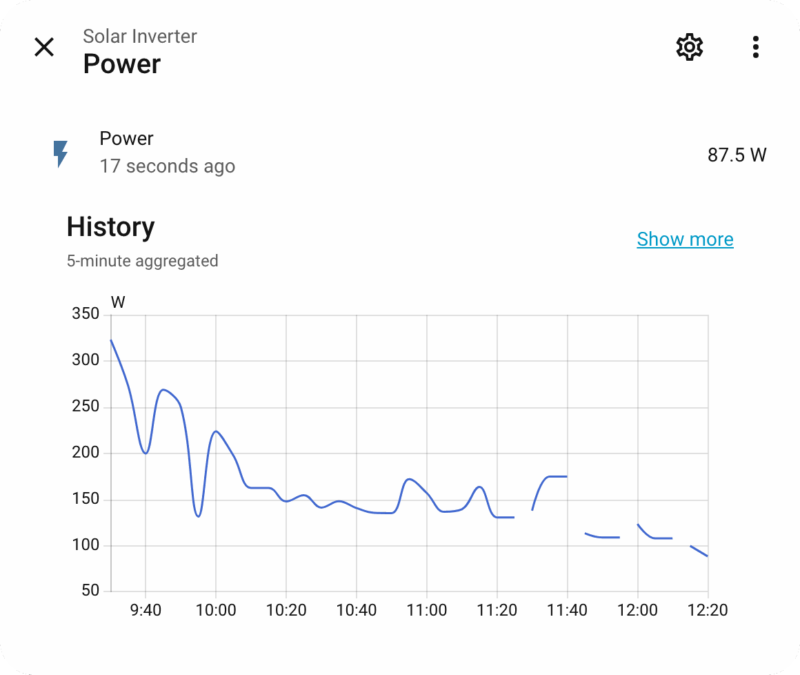
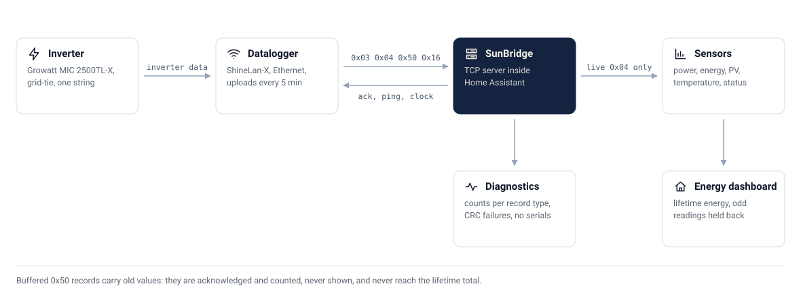

<div align="center">



# ☀️ SunBridge

**Local Growatt solar data in Home Assistant, straight from your ShineLan-X datalogger: no cloud, no wiring, no extra container**


[](https://hacs.xyz)

[](https://github.com/CaputoDavide93/SunBridge/actions/workflows/tests.yaml)

</div>

---


## ✨ Features

SunBridge is a free, open-source Home Assistant integration for Growatt solar
inverters with a **ShineLan-X** datalogger. You point the datalogger at Home
Assistant once, and SunBridge becomes the server it uploads to. Live power,
daily energy and lifetime energy become Home Assistant sensors, the lifetime
total is ready to add to the Energy dashboard, and your solar data never
leaves your network.

### Why SunBridge

Growatt's cloud needs an account (in some countries a new account asks for
an installer code), sends every reading off your network, and goes quiet
when your internet or the cloud does. The local options mean running RS485
wiring to the inverter, or adding an MQTT proxy container and a broker.

SunBridge needs none of that. The datalogger already uploads over your
network; SunBridge receives it inside Home Assistant.

| | SunBridge | Cloud integrations | RS485/Modbus wiring | MQTT proxy containers |
|---|---|---|---|---|
| Growatt account | Not needed | Needed | Not needed | Not needed |
| Internet while running | Not needed | Needed | Not needed | Not needed |
| Extra hardware | None | None | An RS485 adapter and a cable to the inverter | None |
| Extra software | None: installs through HACS | None | A Modbus reader | A proxy container and an MQTT broker |
| How fresh the data is | Every upload, 5 minutes by default | After the cloud has it and the integration polls it | As often as you poll | Every upload |
| Setup | Guided, in Home Assistant's UI | In Home Assistant's UI | Wiring, then configuration | Container, broker and topic configuration |

The one trade-off: the datalogger uploads to one server, so
while it points at Home Assistant the Growatt app gets no new data. You can
[point it back](docs/setup.md#going-back-to-growatts-cloud) at any time.

### Install in 3 steps

1. **Install with HACS:** add `https://github.com/CaputoDavide93/SunBridge`
   as a custom repository of type **Integration**, download **SunBridge**,
   restart Home Assistant.
2. **Add the integration:** **Settings → Devices & services → Add integration
   → SunBridge**.
3. **Follow the guided setup.** It shows the exact settings for the
   datalogger's web page, waits until the datalogger connects, and creates
   the devices.

Details and every screen are in [Quick Start](#-quick-start) and
[docs/setup.md](docs/setup.md).

### What you get

| | Feature | What it does |
|---|---|---|
| 📡 | A server inside Home Assistant | Listens on TCP (port 5279 by default) for the datalogger's uploads, acknowledges `0x03`, `0x04` and `0x50` records as the datalogger expects, and echoes its `0x16` pings |
| 🏠 | Nothing leaves the house | No cloud, no account, no MQTT broker. SunBridge only answers the datalogger, on your own network |
| ⚡ | Live sensors | Power, PV voltage, inverter temperature and status from every live record, each checked against Home Assistant's own history of the same inverter |
| 🔋 | Energy dashboard ready | A lifetime total to add as solar production (by hand, once). Buffered records never reach it, and a single reading the inverter could not have made (lower than the last, or more than 50 kW could add) is ignored, even across restarts; three agreeing live readings accept a reset |
| 🛡️ | Hands off the inverter | SunBridge writes no inverter settings. It sends three things only: the ping echo, the acknowledgement and the datalogger's clock, and a test pins that list |
| 🗃️ | Old data stays old | Buffered records (stored while the server was unreachable) are acknowledged and counted, never shown as current or added to energy |
| 🌙 | Night aware | Live sensors go unavailable when the inverter stops reporting, or two minutes after the datalogger's last connection closes; totals and the last reading time keep their value. Offline and back online are logged once each |
| 🔧 | Repairs | A datalogger silent through three hours of daylight (or 24 hours), counted across restarts, raises a Repairs notice, which clears itself when it reconnects |
| 🔁 | Replaced hardware | A device that is not reporting can be deleted; a second datalogger or inverter is named with its serial |
| 🔌 | Robust link | Records split or joined across reads, bad CRCs dropped and counted, several connections at once, reconnects, idle sockets closed |
| 🧭 | Guided setup | Detects Home Assistant's address, shows the exact datalogger settings, waits for the datalogger and shows its serials |
| ⚙️ | Simple or Advanced | Simple is the port and nothing else. Advanced adds PV current and power, grid voltage, frequency and current, working time, a serial allow-list and the upload interval |
| 🩺 | Diagnostics | Counts per record type, CRC failures, the last frame of each type and open connections, with every serial removed |

<!-- AUTOGEN:status -->
**Status: new.** Version 0.2.0.
<!-- /AUTOGEN:status -->
### Supported hardware

| Hardware | Status |
|---|---|
| Growatt **MIC 2500TL-X** single-phase inverter | ✅ Tested |
| Growatt **ShineLan-X** (Ethernet) datalogger, firmware **3.6.0.2** | ✅ Tested |
| Other Growatt dataloggers whose web page has a **Server IP** setting and that speak the same protocol (ShineWiFi models, for example) | ❔ Likely, unverified |
| Other Growatt single-phase inverters behind such a datalogger (other MIC TL-X sizes, for example) | ❔ Unverified: the register layout may differ |
| Batteries, meters, three-phase inverters | ❌ Not read (never tested) |

Everything was learned from, and is tested against, the tested pair's
captured traffic only. Running other hardware?
[Open an issue](https://github.com/CaputoDavide93/SunBridge/issues) with
your inverter and datalogger models and firmware, and help verify it. This
is an independent project, not affiliated with or endorsed by Growatt.

**What it does not do:** relay data to Growatt's cloud (while the datalogger
points at Home Assistant, the Growatt app gets nothing new), update the
datalogger's firmware, change anything on the datalogger except its clock,
write to the inverter, or read batteries, meters or three-phase inverters (never tested).

---

## 📸 Screenshots

Taken from a real Home Assistant with demo data (`make screenshots`); every
setup screen is in [docs/setup.md](docs/setup.md).

<table>
<tr>
<td width="50%">

<picture>
  <source media="(prefers-color-scheme: dark)" srcset="docs/assets/screenshots/setup-point-dark.png">
  
</picture>

**Setup** shows exactly what to change on the datalogger

</td>
<td width="50%">

<picture>
  <source media="(prefers-color-scheme: dark)" srcset="docs/assets/screenshots/setup-found-dark.png">
  
</picture>

**Then waits** until the datalogger really connects

</td>
</tr>
<tr>
<td width="50%">

<picture>
  <source media="(prefers-color-scheme: dark)" srcset="docs/assets/screenshots/device-inverter-dark.png">
  
</picture>

**Solar Inverter**, live from the datalogger (Advanced mode)

</td>
<td width="50%">

<picture>
  <source media="(prefers-color-scheme: dark)" srcset="docs/assets/screenshots/power-history-dark.png">
  
</picture>

**Power history**, ready for the Energy dashboard

</td>
</tr>
</table>

---

## 🗺️ Architecture

<picture>
  <source media="(prefers-color-scheme: dark)" srcset="docs/assets/architecture-dark.svg">
  
</picture>

The datalogger keeps one TCP connection open and sends a ping about every two
minutes and a live record every upload interval (five minutes by default).
SunBridge acknowledges the announce and data records, echoes the pings,
leaves the datalogger's answers unanswered, and decodes the live records into
sensors. It writes nothing else to the datalogger: no settings, no
upload interval. Every reply equals, byte for byte, what the original server
sent in the captured traffic.

Only live records update sensors. Buffered records are old values the
datalogger stored while it was cut off: SunBridge counts them in diagnostics
and never shows them, so the power never jumps back in time and a replay
never adds to the lifetime total.

[How it works](docs/how-it-works.md) follows a connection step by step.

---

## 🚀 Quick Start

**You need:** a Growatt inverter with a ShineLan-X datalogger, on the same
local network as Home Assistant 2026.9 or newer, the datalogger's IP address
and the login printed on its label, and daylight (the datalogger sleeps with
the inverter). Home Assistant needs a fixed address (a DHCP reservation) and
TCP port 5279 reachable from the datalogger; Docker installs need host
networking or a published port ([Networking](docs/setup.md#-networking)). The full checklist is in [docs/setup.md](docs/setup.md#-before-you-start).

1. **Install.**
   In HACS: **⋮ → Custom repositories**, add
   `https://github.com/CaputoDavide93/SunBridge` as an **Integration**, then
   download **SunBridge** and restart Home Assistant.
2. **Add it:** **Settings → Devices & services → Add integration →
   SunBridge**. The setup walks you through the rest: Simple or Advanced, the
   port (5279), the exact settings for the datalogger's web page with Home
   Assistant's address filled in, then it waits for the datalogger and shows
   what it found.
3. **Energy dashboard:** add `sensor.solar_inverter_energy_total` as solar
   production by hand (SunBridge never changes the Energy settings), after
   removing any other source for the same inverter.

Step by step, with every screen and a checklist: [docs/setup.md](docs/setup.md).
Questions about the Growatt app, internet outages or firmware updates:
[docs/faq.md](docs/faq.md).

---

## 📚 Documentation

| Guide | What it covers |
|---|---|
| [Setup](docs/setup.md) | Before you start, networking, installing, every setup screen with a screenshot, pointing the datalogger, changing the port, going back to the cloud, removing SunBridge |
| [Entities](docs/entities.md) | Every sensor, generated from the code |
| [How it works](docs/how-it-works.md) | The connection step by step, live versus buffered, the energy totals, night |
| [Troubleshooting](docs/troubleshooting.md) | The datalogger's light, symptoms first, then debug logging |
| [FAQ](docs/faq.md) | Internet and account, the Growatt app, other inverters and dataloggers, firmware, safety, the Energy dashboard |
| [Protocol notes](docs/protocol-notes.md) | The wire format, from captured traffic |
| [Data layout](docs/data-layout.md) | Where each value sits in a record, and the evidence |
| [Development](docs/development.md) | Checks, CI, screenshots, layout, tests, fixtures, adding a register, releasing |

---

## ⚙️ Configuration

| Option | Default | Mode | What it does |
|---|---|---|---|
| Port | 5279 | both | TCP port to listen on, checked before it is saved. Change it with **⋮ → Reconfigure**, which goes back to the old port if the new one fails (if that fails too, Repairs names the port to free) |
| Setup mode | Simple | both | Simple: the core sensors. Advanced: the extra sensors and the two options below |
| Allowed datalogger serials | the datalogger found at setup | both, edited in Advanced | Close connections from any other datalogger before answering them. Empty (setup finished before a datalogger connected) accepts any |
| Datalogger upload interval | 5 min (1 to 10) | Advanced | What the datalogger is set to on its own web page. Live sensors go unavailable after three intervals, never sooner than 15 minutes. SunBridge does not change the datalogger |

### Simple or Advanced

<!-- AUTOGEN:modes -->
| | Simple | Advanced |
|---|---|---|
| Sensors | Power, PV voltage, Temperature, Status, Energy today, Energy total, Last reading, Connected | Everything in Simple, plus PV current, PV power, Grid voltage, Grid frequency, Grid current, Working time, and Second temperature (created disabled: unverified) |
| Dataloggers answered | Only the serials in the allow-list: the one setup found, edited in Advanced. Empty (setup finished before one connected, or an entry from 0.1.0) answers any, with a Repairs notice, until the entry knows exactly one datalogger: its next start adopts that one | Only the serials in the allow-list, prefilled with the one setup found and editable (empty accepts any) |
| Upload interval expected | 5 minutes, the datalogger's default | What you enter, 1 to 10 minutes, matching the datalogger |
| Live sensors go unavailable after | 15 minutes without a live record | 3 upload intervals, never less than 15 minutes |
| Setup screens | Welcome, port, datalogger steps, waiting, found (or not yet) | The same, then Advanced Settings |
<!-- /AUTOGEN:modes -->

Switch at any time from **Configure**. Going back to Simple disables the
Advanced sensors, keeping their history and settings; Advanced turns back on
the ones Simple disabled, and a sensor you disabled yourself stays disabled.

---

## 📖 Usage

<!-- AUTOGEN:entities -->
| Entity | Default entity id | Unit | Behaviour | Mode |
|---|---|---|---|---|
| Power | `sensor.solar_inverter_power` | W | Live: unavailable after the stale window | Simple |
| PV voltage | `sensor.solar_inverter_pv_voltage` | V | Live: unavailable after the stale window | Simple |
| Temperature | `sensor.solar_inverter_temperature` | °C | Live: unavailable after the stale window | Simple |
| Status | `sensor.solar_inverter_status` | waiting / producing / fault | Live: unavailable after the stale window | Simple |
| PV current | `sensor.solar_inverter_pv_current` | A | Live: unavailable after the stale window | Advanced |
| PV power | `sensor.solar_inverter_pv_power` | W | Live: unavailable after the stale window | Advanced |
| Grid voltage | `sensor.solar_inverter_grid_voltage` | V | Live: unavailable after the stale window | Advanced |
| Grid frequency | `sensor.solar_inverter_grid_frequency` | Hz | Live: unavailable after the stale window | Advanced |
| Grid current | `sensor.solar_inverter_grid_current` | A | Live: unavailable after the stale window | Advanced |
| Second temperature | `sensor.solar_inverter_second_temperature` | °C | Live: unavailable after the stale window | Advanced, disabled (unverified) |
| Energy today | `sensor.solar_inverter_energy_today` | kWh | Keeps its last value, total increasing | Simple |
| Energy total | `sensor.solar_inverter_energy_total` | kWh | Keeps its last value, total increasing | Simple |
| Last reading | `sensor.solar_inverter_last_reading` | timestamp | Keeps its last value | Simple |
| Working time | `sensor.solar_inverter_working_time` | h | Keeps its last value, total increasing | Advanced |
| Connected | `binary_sensor.solar_datalogger_connected` | on / off | On while an open connection from it has sent a decodable record | Simple |
<!-- /AUTOGEN:entities -->

The power sensor's id contains `solar` and `inverter` and it is a power
sensor, with energy today beside it, so dashboards that discover solar by name
and device class find it. The ids above are the first inverter's and
datalogger's; a second one is named with its serial
([Entities](docs/entities.md)).

---

## 🛠️ Troubleshooting

<details>
<summary><b>Setup says "No Datalogger Yet"</b></summary>

Nothing readable arrived while setup listened. At night that is normal (the
datalogger is off): choose **Finish now**. In daylight, check the datalogger's
Server IP, Server port, ResolvDomain OFF, and that it was rebooted, then
**Try again**. Its light, and more symptoms, in
[docs/troubleshooting.md](docs/troubleshooting.md).

</details>

<details>
<summary><b>Connected stays off</b></summary>

The datalogger is not reaching Home Assistant: check its server IP and port,
and anything between them. A serial missing from the allow-list (in Simple,
the datalogger found at setup) is closed at once.

</details>

<details>
<summary><b>Not verified yet</b></summary>

Tested on one MIC 2500TL-X with a ShineLan-X on firmware 3.6.0.2. Never seen
in its captured traffic, so unverified:

- status code 3 (fault);
- the high word of the 32-bit power and energy values (always 0);
- the second temperature's meaning (register 3097), so it starts disabled;
- the moment the inverter resets energy today;
- changing the upload interval over the TCP link, so SunBridge never tries:
  it is set on the datalogger's own web page.

</details>

---

## 📁 Repo structure

```text
SunBridge/
├── custom_components/
│   └── sunbridge/             # 🧩 the integration: protocol, decoder, server, hub, sensors, flows
│       └── brand/             # 🎨 icons shown in Home Assistant and HACS
├── tests/                     # 🧪 pytest against Home Assistant 2026.9.4
│   └── fixtures/captured/     # 📼 a real datalogger's traffic (serials replaced) and HA's history
├── tools/
│   ├── gen_diagram.py         # 🗺️ draws docs/assets/*.svg
│   ├── gen_docs.py            # 🤖 the generated tables and values in the docs
│   ├── release_notes.py       # 🏷️ tag, manifest and CHANGELOG agree; the release notes
│   └── screenshots/           # 📸 make screenshots: a throwaway HA, a fake datalogger, Playwright
├── docs/                      # 📚 setup, FAQ, entities, how it works, protocol, data layout
│   └── assets/                # 🖼️ diagrams, screenshots, the icon's SVG source, the social preview
├── .github/                   # 🤖 workflows (tests, Hassfest, HACS, CodeQL, release), issue forms, dependabot
├── Makefile                   # 🔧 venv, check, test, lint, typing, diagram, hassfest, screenshots
├── hacs.json  pyproject.toml  pytest.ini  requirements_test.txt
└── CHANGELOG.md  CONTRIBUTING.md  LICENSE  SECURITY.md
```

---

## 🧪 Testing

```bash
make venv     # Home Assistant 2026.9.4 test environment, built with uv
make check    # ruff, strict mypy, pytest with the 95% branch coverage gate, generated docs current
make hassfest # Home Assistant's own validation (needs Docker)
```

Every captured record is checked: CRCs, descrambling, the stream split at
every read size, acknowledgements and clock commands byte for byte against the
captured replies, and each live record's decoded values against Home
Assistant's history of the same moment. End-to-end tests run a fake
datalogger over a real localhost socket, through the whole setup and the
listener.

CI runs the same checks, and the suite again on the oldest supported Home
Assistant (hacs.json's 2026.9.0) and the newest release.

Tests also pin the promises above: SunBridge sends only the ping echo,
the acknowledgement and the datalogger's clock; buffered records never touch
a sensor or the energy totals; and the lifetime total ignores a reading the
inverter could not have made until three live readings agree.

---

## 📦 Deployment

HACS installs and updates it from this repository's releases. Each release is
listed in [CHANGELOG.md](CHANGELOG.md), and its GitHub release carries the
same notes and a `sunbridge.zip` for a manual install; restart Home
Assistant after an update. Removing it: [docs/setup.md](docs/setup.md#removing-sunbridge).

---

## 🔒 Security

The datalogger's protocol has no authentication: keep the port on the LAN.
Diagnostics carry no serials. See [SECURITY.md](SECURITY.md).

---

## 🤝 Contributing

The most useful contribution is a report from other hardware: the
[hardware report form](https://github.com/CaputoDavide93/SunBridge/issues/new/choose)
asks for the inverter and datalogger models, the firmware, and the
integration's diagnostics (they carry no serials). Bugs and ideas have their
own forms; security problems go privately, as [SECURITY.md](SECURITY.md)
says.

Code changes: [CONTRIBUTING.md](CONTRIBUTING.md) covers the development
setup, `make check`, and how to share captured traffic safely.

---

## 📄 License

MIT, see [LICENSE](LICENSE). The protocol was learned only from captured
traffic of the author's own datalogger; no other project's code was read or
used.

An independent project, not affiliated with or endorsed by Growatt. Growatt
and ShineLan are names of their owner, used here only to say what this
integration works with.

---

<p align="center"><sub>Made with ❤️ by <a href="https://github.com/CaputoDavide93">Davide Caputo</a></sub></p>
