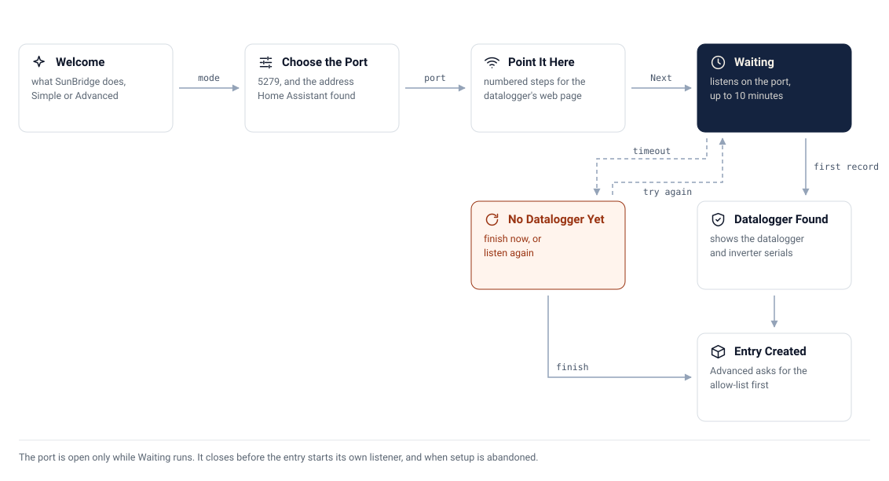

# 🚀 Setup

A walkthrough from nothing to live solar readings, screen by screen. It takes
about fifteen minutes, most of it waiting for the datalogger to restart.

<picture>
  <source media="(prefers-color-scheme: dark)" srcset="assets/setup-flow-dark.svg">
  
</picture>

## ✅ Before you start

- [ ] A Growatt inverter with a **ShineLan-X** datalogger (the only one tested).
      Other Growatt dataloggers whose web page has the same **Server IP**
      setting, such as ShineWiFi models, may work but are untested.
- [ ] The datalogger and Home Assistant on the **same local network**.
- [ ] **Daylight.** The datalogger is powered by the inverter, so it is off
      when there is no sun, and you cannot reach its web page at night.
- [ ] The datalogger's **IP address**, from your router's list of connected
      devices (it often shows up with a name starting with its serial).
- [ ] The **user name and password** printed on the datalogger's label
      (often `admin` / `admin`).
- [ ] Home Assistant 2026.9 or newer.

## 1. Install SunBridge

With [HACS](https://hacs.xyz):

1. Open **HACS**, then the **⋮** menu (top right) → **Custom repositories**.
2. **Repository:** `https://github.com/CaputoDavide93/SunBridge`,
   **Type:** **Integration**, then **Add**.
3. Search HACS for **SunBridge**, open it and click **Download**.
4. Restart Home Assistant (**Settings → System → ⏻ → Restart**).

Without HACS: copy `custom_components/sunbridge/` from the
[latest release](https://github.com/CaputoDavide93/SunBridge/releases) into
Home Assistant's `config/custom_components/`, then restart.

## 2. Add the integration

**Settings → Devices & services → Add integration → SunBridge.** The setup
has up to six screens.

### Welcome to SunBridge

What SunBridge does and what the next screens will ask, and one choice:

| Mode | What you get |
|---|---|
| **Simple** | The core sensors with the defaults. Pick this if unsure |
| **Advanced** | Extra sensors, a datalogger allow-list and the upload interval (a last screen asks for them) |

You can switch later from **Configure**.

### Choose the Port

| Field | Default | What it is |
|---|---|---|
| Port | 5279 | The TCP port SunBridge listens on. 5279 is the port Growatt dataloggers use. Setup refuses a port that something else holds, and explains when another SunBridge entry already listens on it |
| Home Assistant's address | detected | The IPv4 address Home Assistant has on your network, found by Home Assistant's own network settings. Correct it if Home Assistant has more than one network connection. It is only used to fill in the next screen |

### Point Your Datalogger Here

Numbered steps with your address and port already filled in. On the
datalogger's own web page:

1. Open `http://` followed by the datalogger's IP address in a browser.
2. Log in with the user name and password from its label.
3. **Network Setting:** note down the values there, so you can go back to
   Growatt's cloud later.
4. Set **ResolvDomain** to **OFF**, **Server IP** to
   Home Assistant's address and **Server port** to the port. Click **Save**.
5. **Datalogger Setting:** set **Reboot** to **yes** and click **Save**.

Then press **Next** on the setup screen.

### Waiting for Your Datalogger

SunBridge now listens on the port and answers the datalogger exactly as it
will from then on. The screen moves on by itself as soon as the datalogger
sends a record SunBridge can read (pings alone do not count). After a reboot
that is usually two or three minutes.

<!-- AUTOGEN:setup-wait -->
It listens for up to **10 minutes**.
<!-- /AUTOGEN:setup-wait -->

If you close the dialog, SunBridge stops listening and the port is free
again.

### Datalogger Found

The datalogger's serial and the inverter's serial, as the datalogger sent
them. Continue, and the entry is created (Advanced shows one more screen).

### No Datalogger Yet

Shown when nothing arrived in time. Two choices:

- **Finish now:** the entry is created anyway, and the datalogger appears as
  soon as it connects. The right choice at night.
- **Try again:** listen once more. Use it after fixing a setting.

### Advanced Settings (Advanced only)

| Field | Default | What it does |
|---|---|---|
| Allowed datalogger serials | the datalogger just found | Comma-separated. A connection from any other serial is closed before anything is answered. Empty accepts any datalogger |
| Datalogger upload interval | 5 min (1 to 10) | What the datalogger is set to on its own web page. SunBridge does **not** change the datalogger; it uses this to decide when live values are out of date (three intervals, at least 15 minutes) |

## 3. Check it worked

- `binary_sensor.solar_datalogger_connected` is on.
- `sensor.solar_inverter_power` shows a number after the first live record
  (every upload interval, five minutes by default).
- **Settings → Devices & services → SunBridge → ⋮ → Download diagnostics**:
  `records.by_type` counts what arrived, `crc_failures` should be 0.

## 4. Energy dashboard

**Settings → Dashboards → Energy → Solar panels → Add solar production**, and
pick `sensor.solar_inverter_energy_total`. If another integration already
feeds the same inverter (Growatt's cloud integration, for example), remove it
from the dashboard first, or the energy is counted twice.

## Changing settings later

**Settings → Devices & services → SunBridge → Configure** changes the port and
the mode, and the Advanced settings. Saving reloads the listener, and the
datalogger reconnects. A new port must also be set on the datalogger. Going
back from Advanced to Simple removes the Advanced sensors.

## Going back to Growatt's cloud

On the datalogger's web page, **Network Setting**: set **ResolvDomain** to
**ON** and put back the server values you noted in step 3, **Save**, then
**Datalogger Setting → Reboot → yes → Save**. The datalogger uploads to
Growatt again, and the Growatt app shows new data. SunBridge's Connected
sensor turns off; remove the integration if you no longer want it.
