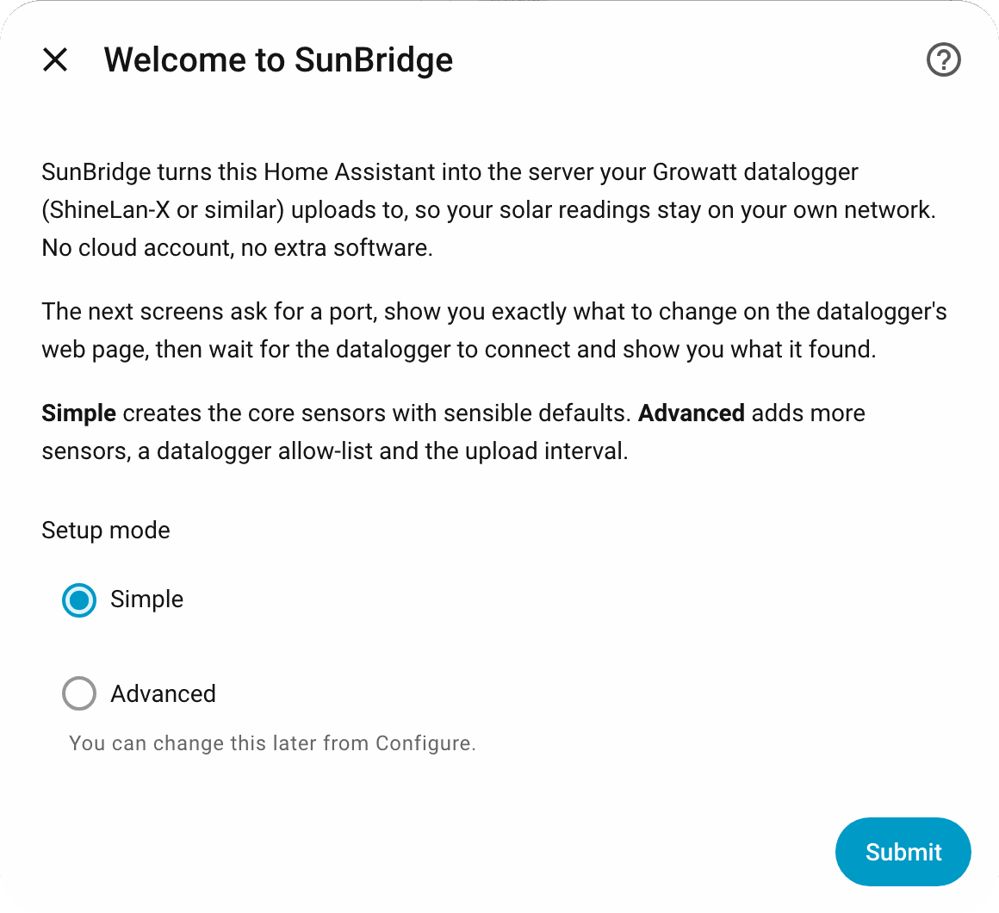
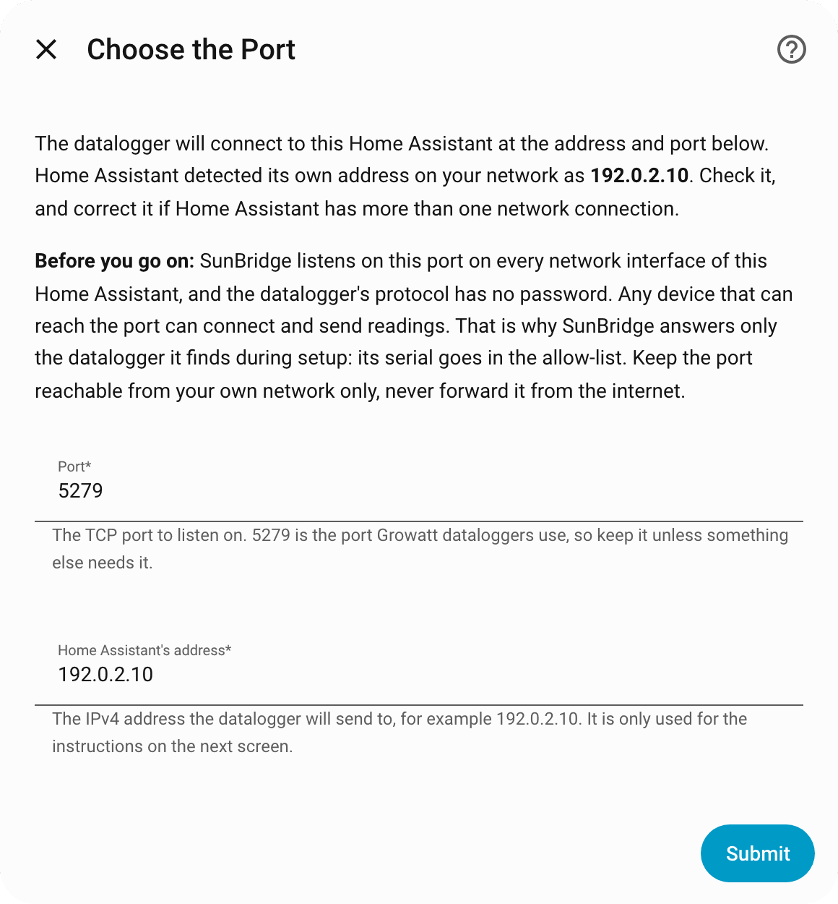
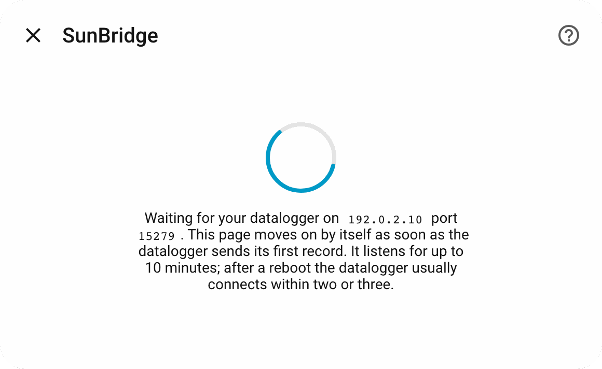
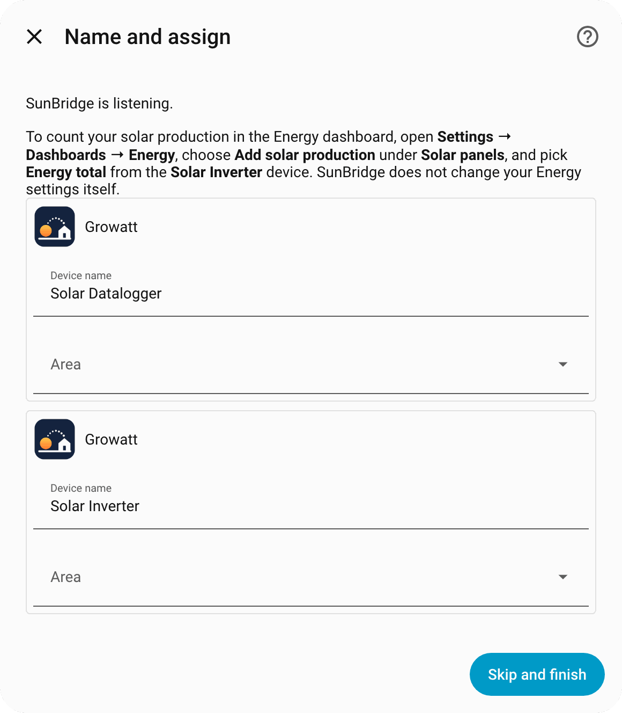
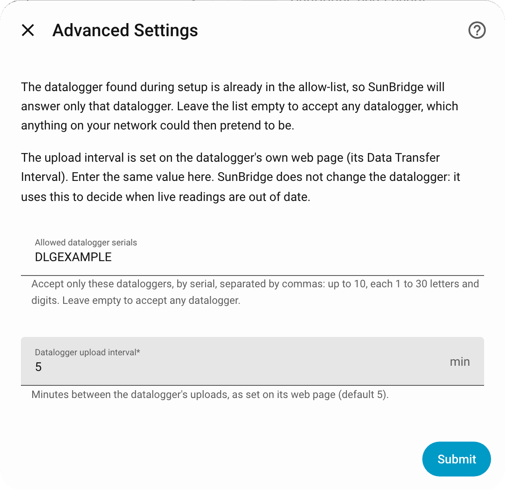
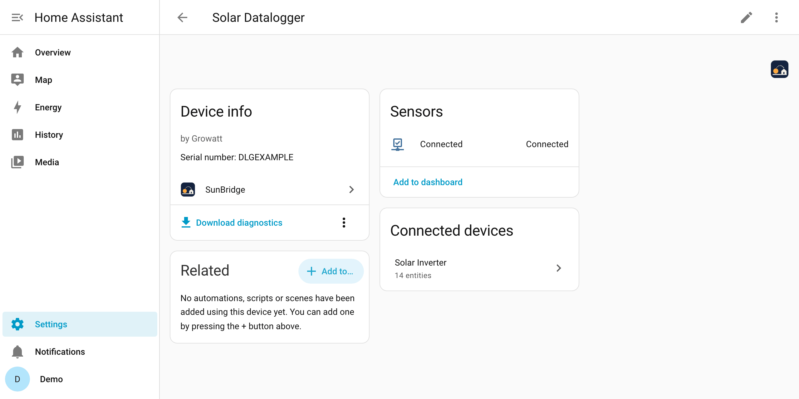
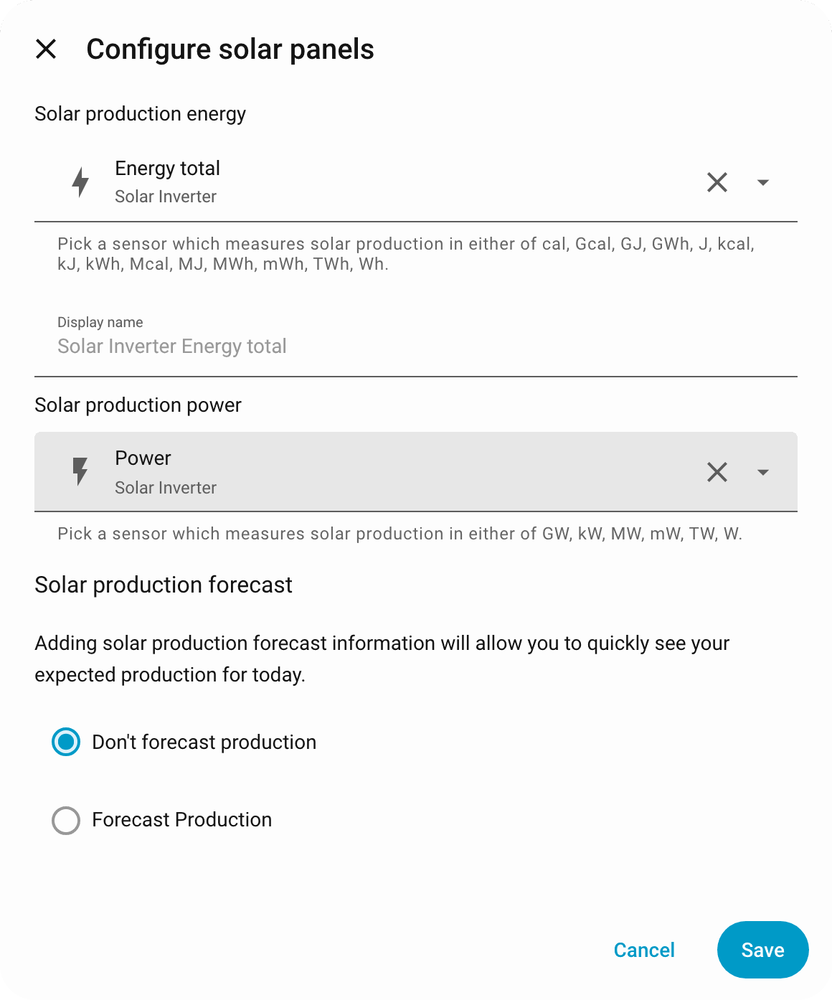
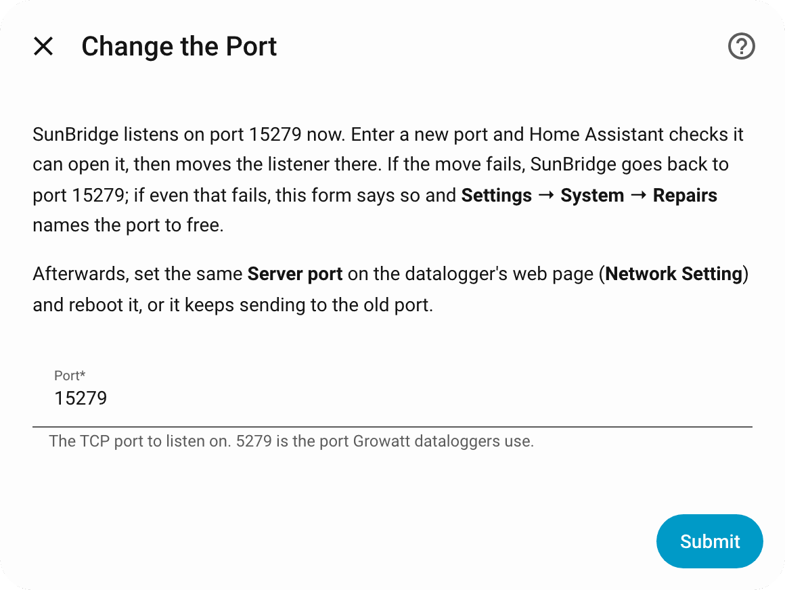

# 🚀 Setup

A walkthrough from nothing to live solar readings, screen by screen. It takes
about fifteen minutes, most of it waiting for the datalogger to restart.

The screenshots come from a test Home Assistant with demo data
(`make screenshots`): its address is the documentation address 192.0.2.10,
and after the port screen it listens on 15279, so the later screens show
that port. Yours show your own address and the port you chose (5279 unless
you changed it).

<picture>
  <source media="(prefers-color-scheme: dark)" srcset="assets/setup-flow-dark.svg">
  
</picture>

## ✅ Before you start

- [ ] A Growatt inverter with a **ShineLan-X** datalogger (the only one tested).
      Other Growatt dataloggers whose web page has the same **Server IP**
      setting, such as ShineWiFi models, may work but are untested.
- [ ] The datalogger and Home Assistant on the **same local network**, or
      a firewall rule that lets the datalogger reach Home Assistant on TCP
      port 5279 (see [Networking](#-networking)).
- [ ] A **fixed address for Home Assistant**: a DHCP reservation in your
      router, or a static address. The datalogger stores the address as
      numbers, so if Home Assistant's address changes, the datalogger loses
      it.
- [ ] **Daylight.** The datalogger is powered by the inverter, so it is off
      when there is no sun, and you cannot reach its web page at night.
- [ ] The datalogger's **IP address**, from your router's list of connected
      devices (it often shows up with a name starting with its serial).
- [ ] The **user name and password** printed on the datalogger's label
      (often `admin` / `admin`).
- [ ] Home Assistant 2026.9 or newer.

## 🌐 Networking

The datalogger opens the connection, to Home Assistant's address on the port
you choose (5279 unless you change it). Home Assistant never connects to the
datalogger. So three things must be true:

| What | Why | How |
|---|---|---|
| Home Assistant's address does not change | The datalogger keeps the numbers you type into its **Server IP** | Reserve the address for Home Assistant in your router's DHCP settings, or give it a static one |
| TCP port 5279 reaches Home Assistant itself | SunBridge listens inside Home Assistant's own process | See the table below for your installation type |
| Nothing between them blocks it | Firewalls and VLAN rules drop the connection silently | If the datalogger is on another VLAN or subnet (an IoT network, for example), allow TCP from the datalogger to Home Assistant's address on port 5279 |

| Installation | What to do |
|---|---|
| Home Assistant OS, Supervised | Nothing: Home Assistant uses the host's network, so the port is reachable |
| Container (Docker, Podman) | Run the container with host networking (`network_mode: host`, as Home Assistant recommends), or publish the port (`-p 5279:5279`, or `ports: ["5279:5279"]` in Compose). With a published port, correct **Home Assistant's address** on the port screen to the host's LAN address: the detected one is the container's |
| Core (Python virtual environment) | Allow TCP 5279 in the host's firewall (`ufw`, `firewalld`, or similar) |

### Check the port from another device

Before you change anything on the datalogger, make sure the port answers.
SunBridge listens only while setup waits for the datalogger, or once the
entry exists, so:

1. Go through the setup up to **Point Your Datalogger Here**, but press
   **Next** before touching the datalogger. The waiting screen now listens
   for up to 10 minutes.
2. From a phone or laptop on the **datalogger's** network, test the port
   (use Home Assistant's address and your port):

   ```bash
   nc -vz 192.0.2.10 5279                                # macOS, Linux
   ```

   ```powershell
   Test-NetConnection -ComputerName 192.0.2.10 -Port 5279  # Windows
   ```

   `succeeded`, `open` or `TcpTestSucceeded : True` means the datalogger
   can reach SunBridge too. A connection like this one sends no record, so
   the waiting screen keeps waiting.
3. Now change the datalogger's settings and reboot it, as the screen says.
   If the 10 minutes run out first, choose **Try again**.

A timeout means a firewall, a VLAN rule or a missing Docker port is in the
way; "refused" means nothing listens on that address and port (a wrong
address, a container without host networking or a published port, or the
setup is no longer waiting). Fix that first: nothing on the datalogger has
changed yet.

## 1. Install SunBridge

With [HACS](https://hacs.xyz):

1. Open **HACS**, then the **⋮** menu (top right) → **Custom repositories**.
2. **Repository:** `https://github.com/CaputoDavide93/SunBridge`,
   **Type:** **Integration**, then **Add**.
3. Search HACS for **SunBridge**, open it and click **Download**.
4. Restart Home Assistant (**Settings → System → ⏻ → Restart**).

Without HACS: copy `custom_components/sunbridge/` from the
[latest release](https://github.com/CaputoDavide93/SunBridge/releases) into
Home Assistant's `config/custom_components/`, then restart.

## 2. Add the integration

**Settings → Devices & services → Add integration → SunBridge.** The setup
has up to six screens.

### Welcome to SunBridge

<picture>
  <source media="(prefers-color-scheme: dark)" srcset="assets/screenshots/setup-welcome-dark.png">
  
</picture>

What SunBridge does and what the next screens will ask, and one choice:

| Mode | What you get |
|---|---|
| **Simple** | The core sensors with the defaults. Pick this if unsure |
| **Advanced** | Extra sensors, a datalogger allow-list and the upload interval (a last screen asks for them) |

You can switch later from **Configure**.

When setup finishes, Home Assistant shows a message with the way to the
Energy dashboard: **Settings → Dashboards → Energy → Add solar production**,
then **Energy total** from the **Solar Inverter** device (see
[step 4](#4-energy-dashboard)). SunBridge never changes your Energy settings
itself.

### Choose the Port

<picture>
  <source media="(prefers-color-scheme: dark)" srcset="assets/screenshots/setup-port-dark.png">
  
</picture>

| Field | Default | What it is |
|---|---|---|
| Port | 5279 | The TCP port SunBridge listens on. 5279 is the port Growatt dataloggers use. Setup refuses a port that something else holds, and explains when another SunBridge entry already listens on it |
| Home Assistant's address | detected | The IPv4 address Home Assistant has on your network, found by Home Assistant's own network settings. Correct it if Home Assistant has more than one network connection. It is only used to fill in the next screen |

The screen itself carries the same warning as the box below.

> [!WARNING]
> SunBridge listens on **every network interface** of the Home Assistant
> host, and the datalogger's protocol has no password: anything that can
> reach the port can send records. Keep the port on your LAN, never forward
> it from the internet, and rely on the allow-list (set for you, see
> [Datalogger Found](#datalogger-found)). More in
> [SECURITY.md](../SECURITY.md).

### Point Your Datalogger Here

<picture>
  <source media="(prefers-color-scheme: dark)" srcset="assets/screenshots/setup-point-dark.png">
  
</picture>

Numbered steps with your address and port already filled in. On the
datalogger's own web page:

1. Open `http://` followed by the datalogger's IP address in a browser.
2. Log in with the user name and password from its label.
3. **Network Setting:** note down the values there, so you can go back to
   Growatt's cloud later.
4. Set **ResolvDomain** to **OFF**, **Server IP** to
   Home Assistant's address and **Server port** to the port. Click **Save**.
5. **Datalogger Setting:** set **Reboot** to **yes** and click **Save**.

Then press **Next** on the setup screen.

### Waiting for Your Datalogger

<picture>
  <source media="(prefers-color-scheme: dark)" srcset="assets/screenshots/setup-wait-dark.png">
  
</picture>

SunBridge now listens on the port and answers the datalogger exactly as it
will from then on. The screen moves on by itself as soon as the datalogger
sends a record SunBridge can read (pings alone do not count). After a reboot
that is usually two or three minutes.

<!-- AUTOGEN:setup-wait -->
It listens for up to **10 minutes**.
<!-- /AUTOGEN:setup-wait -->

If you close the dialog, SunBridge stops listening and the port is free
again.

### Datalogger Found

<picture>
  <source media="(prefers-color-scheme: dark)" srcset="assets/screenshots/setup-found-dark.png">
  
</picture>

The datalogger's serial and the inverter's serial, as the datalogger sent
them. Continue, and the entry is created (Advanced shows one more screen).
In Simple mode this datalogger becomes the entry's allow-list: a connection
from any other serial is closed unanswered. To accept a different
datalogger, switch to Advanced in **Configure** and edit the list.
Home Assistant then offers to name the two new devices and put them in an
area; **Skip and finish** keeps the names SunBridge gives them.

<picture>
  <source media="(prefers-color-scheme: dark)" srcset="assets/screenshots/setup-created-dark.png">
  
</picture>

### No Datalogger Yet

Shown when nothing arrived in time. Two choices:

- **Finish now:** the entry is created anyway, and the datalogger appears as
  soon as it connects. The right choice at night. The port is checked again
  first. No datalogger has been seen, so the allow-list stays empty: any
  datalogger that connects is answered, and **Settings → System → Repairs**
  says so. Once your datalogger has connected, the next start of the entry
  (a restart, or a reload) puts its serial in the allow-list and the notice
  goes away; or add it yourself under **Configure → Advanced**. If the port
  can no longer be opened, you are taken back to the port screen.
- **Try again:** listen once more. Use it after fixing a setting.

### Advanced Settings (Advanced only)

<picture>
  <source media="(prefers-color-scheme: dark)" srcset="assets/screenshots/setup-advanced-dark.png">
  
</picture>

| Field | Default | What it does |
|---|---|---|
| Allowed datalogger serials | the datalogger just found | Comma-separated, up to 10 serials, each 1 to 30 letters and digits, no duplicates. A connection from any other serial is closed before anything is answered. Letters are upper-cased. Empty accepts any datalogger |
| Datalogger upload interval | 5 min (1 to 10) | What the datalogger is set to on its own web page. SunBridge does **not** change the datalogger; it uses this to decide when live values are out of date (three intervals, at least 15 minutes) |

## 3. Check it worked

- `binary_sensor.solar_datalogger_connected` is on.
- `sensor.solar_inverter_power` shows a number after the first live record
  (every upload interval, five minutes by default).
- **Settings → Devices & services → SunBridge → ⋮ → Download diagnostics**:
  `records.by_type` counts what arrived, `crc_failures` should be 0.

<picture>
  <source media="(prefers-color-scheme: dark)" srcset="assets/screenshots/device-inverter-dark.png">
  
</picture>

The **Solar Inverter** device (Settings → Devices & services → SunBridge),
here in Advanced mode; Simple shows the core sensors only. Its datalogger,
**Solar Datalogger**, holds the Connected sensor:

<picture>
  <source media="(prefers-color-scheme: dark)" srcset="assets/screenshots/device-datalogger-dark.png">
  
</picture>

Clicking **Power** in the device page shows its history:

<picture>
  <source media="(prefers-color-scheme: dark)" srcset="assets/screenshots/power-history-dark.png">
  
</picture>

## 4. Energy dashboard

SunBridge does not add itself to the Energy dashboard: you do it once, by
hand. **Settings → Dashboards → Energy → Solar panels → Add solar
production**, and pick **Energy total** of **Solar Inverter**
(`sensor.solar_inverter_energy_total`), the inverter's lifetime counter.
The same dialog can also take `sensor.solar_inverter_power` as the solar
production power. Leave **Energy today** out: the dashboard needs only one
energy source per inverter.

If another integration already feeds the same inverter (Growatt's cloud
integration, for example), remove it from the dashboard first, or the
energy is counted twice.

What SunBridge does to keep the total honest:

- **Buffered records never reach it.** Records the datalogger stored while
  it was cut off are acknowledged and counted, never shown, so a replay
  cannot add the same energy again.
- **An impossible reading is ignored.** A single reading the inverter could
  not have made, lower than the last or more than 50 kW could have added in
  the time since, is ignored and counted (`lifetime_decreases_ignored`,
  `lifetime_jumps_ignored` in diagnostics), even across restarts: the
  restored total and reading time are what the first new reading is checked
  against. The dashboard never sees a fall and a climb back.
- **A real reset is accepted.** Three live readings in a row that agree with
  each other (a counter reset, a replaced inverter board) become the new
  total, and the dashboard starts a new cycle from it instead of freezing.
  Buffered readings never count towards the three.

**Energy today** is the inverter's raw daily counter, 0 from Home Assistant's
local midnight until the first live reading of the day. Leave it out of the
dashboard and use **Energy total**.

<picture>
  <source media="(prefers-color-scheme: dark)" srcset="assets/screenshots/energy-solar-dark.png">
  
</picture>

## Changing settings later

**Settings → Devices & services → SunBridge → Configure** changes the mode
and the Advanced settings. Saving reloads the listener, and the datalogger
reconnects. Going back from Advanced to Simple disables the Advanced sensors,
keeping their history and settings, and expects the default 5-minute upload
interval again; switching to Advanced turns back on the sensors Simple
disabled (one you disabled yourself stays disabled). The allow-list applies
in both modes: in Simple it is what setup or Advanced last saved; choose
Advanced to edit it.

The port is not under Configure, but under **Reconfigure**:

### Change the Port

**Settings → Devices & services → SunBridge → ⋮ → Reconfigure** changes the
port. Home Assistant checks it can open the new port while the old listener
keeps running, then moves the listener; if the move fails, SunBridge goes
back to the old port and the form says the port is unavailable. If going
back fails too (something took the old port in the meantime), the form
closes saying so, nothing is listening, and **Settings → System → Repairs**
names the port to free; the notice clears itself once SunBridge listens
again, after you free the port and reload the entry. A port
another SunBridge entry uses is refused. The entry's name follows the port
unless you renamed it. Then set the same **Server port** on the datalogger's
**Network Setting** page and reboot it.

<picture>
  <source media="(prefers-color-scheme: dark)" srcset="assets/screenshots/setup-reconfigure-dark.png">
  
</picture>

### Replacing a datalogger or inverter

The new one appears as a new device, named with its serial while the old
device is still there. Add a new datalogger's serial to the allow-list under
**Configure → Advanced**, or it is refused. Delete the old device from its
page (**⋮ → Delete**) once it no longer reports: SunBridge refuses to delete
a datalogger that is connected or an inverter whose live sensors are
current. A deleted device that reports again comes back.

## Going back to Growatt's cloud

On the datalogger's web page, **Network Setting**: set **ResolvDomain** to
**ON** and put back the server values you noted in step 3, **Save**, then
**Datalogger Setting → Reboot → yes → Save**. The datalogger uploads to
Growatt again, and the Growatt app shows new data. SunBridge's Connected
sensor turns off; to remove SunBridge too, read on.

## Removing SunBridge

In this order, so the datalogger always has a server to upload to:

1. **Point the datalogger back at Growatt's cloud** (above): **ResolvDomain**
   **ON**, the original server values, reboot. Skip this only if you are
   retiring the datalogger.
2. **Remove the integration:** **Settings → Devices & services → SunBridge →
   ⋮ → Delete**. SunBridge closes its port and every connection at once, so
   the port is free for anything else without a restart.
3. **Clean up the Energy dashboard:** **Settings → Dashboards → Energy**,
   remove **Energy total** from Solar panels (and the solar power, if you
   added it). Or keep it there, if you want past solar production to stay
   in the dashboard's charts: they read the long-term statistics, which
   stay (see below).
4. **Uninstall it from HACS:** **HACS → SunBridge → ⋮ → Remove**. Without
   HACS, delete `config/custom_components/sunbridge/`.
5. **Restart Home Assistant** (**Settings → System → ⏻ → Restart**), so
   the integration's code is no longer loaded.

What stays and what goes:

| | After removal |
|---|---|
| The **Solar Inverter** and **Solar Datalogger** devices, and their entities | Removed with the integration |
| Recorded history of those entities | Stays in Home Assistant's database until the recorder purges it (10 days by default) |
| Long-term statistics (hourly energy and power), and so the Energy dashboard's past | Stay until you delete them in **Developer tools → Statistics** |
| The datalogger's settings | Whatever you left them: step 1 is the only way back to the cloud |
